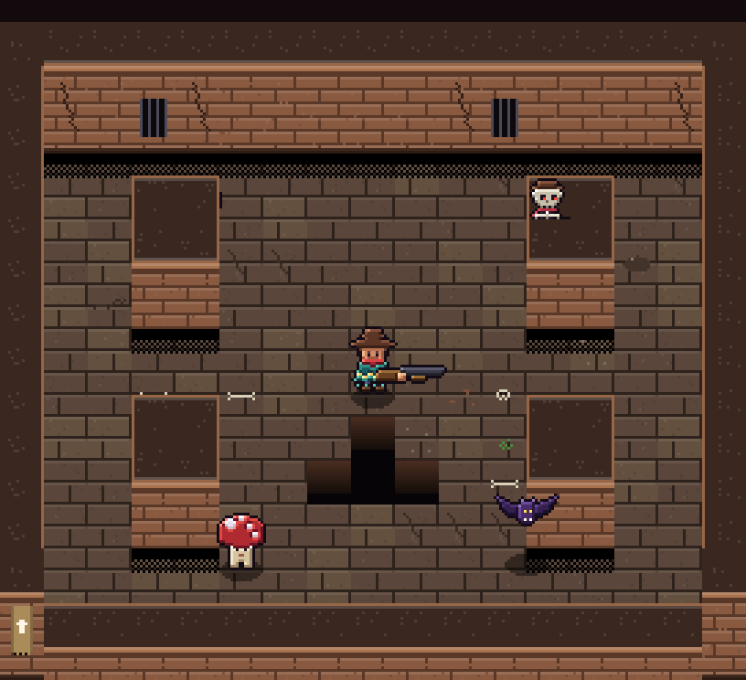

# Ecos do Gatilho (Unity 6)

Roguelike *bullet hell* em **2.5D** no estilo dos dungeon crawlers de visão 3/4: 5 andares procedurais,
cambalhota com invulnerabilidade, 10 armas, 8 inimigos e 5 chefes. Feito em **Unity 6 (Built-in Render Pipeline)**,
com todo o conteúdo montado por código — não há cenas ou prefabs para configurar.



> A imagem acima é uma prévia estática gerada com a mesma projeção e os mesmos sprites do jogo
> (`Tools/ArtGen/mock_render.py`). A versão web antiga (Three.js) continua na branch `web`.

## Como abrir

1. Unity Hub → **Add project from disk** → selecione esta pasta.
2. Abra com **Unity 6000.0.85f1** (ou mais novo da linha 6000.x).
3. Na primeira abertura o script `Assets/Editor/ProjectSetup.cs` importa a arte como pixel art,
   cria `Assets/Scenes/Main.unity` e coloca a cena no Build Settings.
4. Aperte **Play**. (O jogo também inicia sozinho em qualquer cena, inclusive vazia.)

Se algo da arte aparecer borrado, use o menu **Ecos → Configurar projeto**.

## Controles

| Ação | Tecla |
| --- | --- |
| Mover | `W A S D` / setas |
| Mirar / atirar | mouse / botão esquerdo (segure para automático) |
| Cambalhota (invulnerável no início) | `Espaço` ou botão direito |
| Recarregar | `R` |
| Blank (apaga as balas inimigas) | `Q` |
| Interagir (baús, loja, armas, alçapão) | `E` |
| Trocar arma | `1–9` ou roda do mouse |
| Pausar | `Esc` / `P` |
| Câmera 3D experimental | `F2` (no 3D, `Shift+Q/E` gira) |
| Depuração (Editor) | `F1` modo deus · `F3` pular de andar |

## Visual 2.5D

- **Câmera ortográfica a 45° com projeção "cabinet"**: o chão aparece sem achatamento (1 tile = 16×16 px)
  e a face frontal das paredes aparece com a altura real. As laterais das paredes ficam de perfil — nada
  de visão "lateralizada".
- **O mundo é 3D de verdade**: paredes altas (2 tiles), pilares (1,5), mureta de baixo (0,75), poços e caixas.
  Personagens são sprites em pé com sombra no chão, então pulos, a cambalhota e inimigos voadores mostram altura.
- **Pixel perfect**: renderiza numa textura de ~480×270 e amplia em escala inteira, sem filtro.
- **Luz estilizada**: shader próprio com até 16 luzes (tochas, jogador, tiros, explosões) em degraus.

## Estrutura

```
Assets/
  Editor/ProjectSetup.cs        configuração automática do projeto
  Resources/Art/                spritesheets PNG + atlas.json (gerados por Tools/ArtGen)
  Resources/Shaders/            PixelLit, PixelAdditive, PixelBlend, PixelUI
  Scripts/
    Core/        GameManager (estados, salas, combate), Bootstrap, Rng
    Rendering/   PixelCamera (2.5D/3D), SpriteLib, SpriteView, materiais e luzes
    World/       DungeonGen (mapa procedural), RoomTemplates (salas desenhadas), LevelBuilder (geometria)
    Entities/    Player, Weapons, Enemies, Boss, Bullets, Items, Effects
    Net/         PlayerInputState (base para o co-op online)
    UI/          UiDraw (interface pixel perfect) e Hud
    Audio/       Sfx (sons sintetizados)
Tools/ArtGen/                   gerador da pixel art em Python (Pillow)
Docs/                           arquitetura, guia de sprites e prévias
```

- [Docs/ARQUITETURA.md](Docs/ARQUITETURA.md) — como funcionam câmera, mapa e o plano para co-op online.
- [Docs/SPRITES.md](Docs/SPRITES.md) — como trocar a arte pelos seus spritesheets.

## Regerar a arte

```bash
pip install pillow
python3 Tools/ArtGen/build.py        # recria Assets/Resources/Art
python3 Tools/ArtGen/mock_render.py  # recria as prévias em Docs/
```
